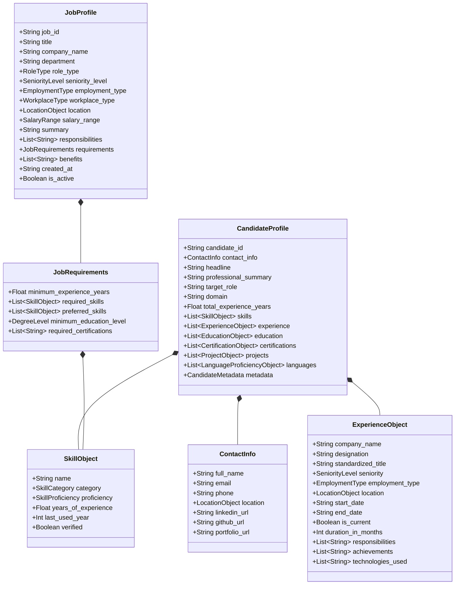

# Zecpath AI — Data Understanding & Structuring Design Document (Day 4)

**Document Version:** 1.0.0  
**Phase:** Day 4 — Data Understanding & Structuring  
**Status:** Approved & Verified  
**Author / Engineering Team:** Zecpath AI Engineering  

---

## 1. Executive Summary

In hiring and applicant screening, the primary barrier to automated, objective talent evaluation is the unstructured, highly variable nature of candidate resumes and job descriptions. Unstructured documents contain varying layouts, inconsistent date formats, ambiguous job titles, and unstandardized skill mentions.

The goal of **Day 4: Data Understanding & Structuring** is to:
1. Deeply analyze candidate resumes across **10 distinct industry domains** (technical and non-technical).
2. Examine job descriptions for **technical and non-technical vacancies**.
3. Establish a canonical data taxonomy for **Skills, Experience, Designations, Education, and Certifications**.
4. Define standard AI data entities (`CandidateProfile`, `JobProfile`, `SkillObject`, `ExperienceObject`).
5. Design and validate formal **JSON Schemas** (conforming to JSON Schema Draft 2020-12) to serve as the strict contract for downstream AI screening, ATS keyword scoring, and interview agents.

---

## 2. Multi-Domain Dataset Analysis

To ensure generalizability, 10 distinct resumes and 4 job descriptions were analyzed across tech, design, business, finance, and operations.

### 2.1 Domain Analysis Matrix

| # | Domain | Sample Candidate | Key Structural Patterns | Extraction Challenges |
|---|---|---|---|---|
| **1** | **Backend Software Engineering** | Alex Chen | High density of distributed systems tech, protocols (gRPC, Kafka), microservices metrics ($40M volume, p99 latency). | Distinguishing architectural experience from peripheral tool mentions. |
| **2** | **Frontend / Full-Stack** | Priya Sharma | Web standards, framework ecosystems (React, Next.js), design system tokens, Core Web Vitals (LCP, FID). | Overlapping full-stack vs frontend boundaries; rapidly evolving tool names. |
| **3** | **Data Science & ML / AI** | Dr. Marcus Vance | Academic research credentials (Ph.D.), model architectures (LLMs, LoRA, RAG), mathematical foundation. | Separating applied engineering from theoretical publications. |
| **4** | **DevOps & Cloud Infrastructure** | Elena Rostova | IaC modules, multi-region cloud SLA percentages (99.999%), zero-trust security compliance. | Distinguishing direct automation from managed infrastructure usage. |
| **5** | **Cybersecurity & Threat Analysis** | David Okafor | Industry frameworks (MITRE ATT&CK, NIST CSF), credential acronyms (CISSP), SOC alert volumes. | Highly specific certification acronyms and compliance jargon. |
| **6** | **Product Management** | Rachel Kim | Business impact metrics (ARR growth, conversion rate lifts), sprint cadence, cross-functional collaboration. | Translating qualitative product initiatives into concrete skill competencies. |
| **7** | **UI/UX Product Design** | Mateo Silva | Design systems (tokens, variables), usability benchmarking, portfolio URLs, user retention lifts. | Heavy reliance on visual portfolios; quantifying design outcomes. |
| **8** | **HR & Talent Acquisition** | Sarah Jenkins | Sourcing channels, ATS platforms (Greenhouse, Ashby), recruiting funnel metrics (Time-to-Fill, Offer Acceptance). | Non-standard title progression and soft-skill heavy narratives. |
| **9** | **Financial Analysis & Modeling** | Vikram Patel | 3-statement modeling, valuation methodologies (DCF, LBO), accounting standards (US GAAP, ASC 606). | Industry credentials (CFA) tied to strict compliance; variance accuracy metrics. |
| **10** | **Digital Growth & Marketing** | Chloe Dupont | Paid acquisition channels (Google Ads, Meta), analytics (GA4), conversion funnels, CAC/LTV ratios. | Channel-specific metrics varying by business model (B2B vs B2C). |

---

## 3. Extraction Patterns & Entity Identification

Through systematic review of the multi-domain dataset, five foundational patterns were identified:

### 3.1 Skill Taxonomy Patterns
Skills fall into distinct semantic buckets that require categorical partitioning:
- **TECHNICAL**: Core programming languages, distributed systems, system design (e.g., *Go, Python, SQL*).
- **FRAMEWORK**: Application frameworks and libraries (e.g., *React, Next.js, PyTorch*).
- **TOOL**: Developer and productivity software (e.g., *Figma, Docker, Splunk, Greenhouse, Excel*).
- **DATABASE**: Relational, document, and vector stores (e.g., *PostgreSQL, Redis, Pinecone*).
- **CLOUD_DEVOPS**: Cloud infrastructure and orchestration (e.g., *AWS, Kubernetes, Terraform*).
- **DOMAIN**: Sector-specific knowledge (e.g., *US GAAP, MITRE ATT&CK, Product Strategy*).
- **METHODOLOGY**: Process and operational frameworks (e.g., *Agile Scrum, A/B Testing, Threat Hunting*).
- **Proficiency Tracking**: Explicit self-ratings ("Expert in React") vs inferred experience duration.

### 3.2 Experience Patterns
- **Timeline Discrepancies**: Resumes express dates as year-only (`2021`), month-year (`03/2021`, `March 2021`), or relative (`Present`). Standard format adopted: `YYYY` or `YYYY-MM`.
- **Achievement Quantification (STAR Method)**: High-quality candidates structure points with Situation, Task, Action, and Result (e.g., *"Reduced API p99 latency from 320ms to 45ms by introducing Redis caching clusters"*). The schema preserves quantified achievements separately from general duties.

### 3.3 Designation & Seniority Hierarchy
Titles vary widely across companies (e.g., *"Member of Technical Staff 2"*, *"Ninja Developer"*, *"Associate Vice President"*).
We map designations into a standardized 8-tier seniority hierarchy:
1. `ENTRY` (0 - 1 years)
2. `JUNIOR` (1 - 3 years)
3. `MID` (3 - 5 years)
4. `SENIOR` (5 - 8 years)
5. `LEAD` (7 - 10 years)
6. `PRINCIPAL` (10+ years / Staff / Architect)
7. `DIRECTOR` (Engineering / Department Management)
8. `EXECUTIVE` (VP, C-Level)

### 3.4 Education Structures
- **Degree Standardization**: Normalized into `HIGH_SCHOOL`, `ASSOCIATE`, `BACHELOR`, `MASTER`, `DOCTORATE`, `DIPLOMA`, `CERTIFICATE`.
- **Grading Formats**: GPA scales (4.0, 5.0, 10.0), percentages (e.g., 85%), or honors (First Class Honors, Magna Cum Laude).

### 3.5 Certifications & Licensure
Credentials require tracking issuing authority (AWS, CFA Institute, (ISC)², Scrum Alliance), date of issuance, expiration dates, and verification IDs to prevent credential hallucination.

---

## 4. Standard AI Data Entities Architecture



---

## 5. Schema Formats & Implementation

The schemas are generated and verified via Pydantic v2 and exported into JSON Schema Draft 2020-12 specifications:

1. **Resume Schema**: [`data/schemas/resume_schema.json`](file:///c:/Users/dhanu/Downloads/Zescer/zecpath-ai/data/schemas/resume_schema.json)
2. **Job Description Schema**: [`data/schemas/job_description_schema.json`](file:///c:/Users/dhanu/Downloads/Zescer/zecpath-ai/data/schemas/job_description_schema.json)

### Key Schema Design Decisions:
- **Strict Typing with Enums**: Using `StrEnum` ensures consistent JSON serialization and prevents arbitrary strings for categorical fields (like `SkillCategory` or `SeniorityLevel`).
- **ISO 8601 Compliance**: Date formats enforce `YYYY` or `YYYY-MM` via regular expression patterns (`^\d{4}(-\d{2})?$`).
- **Defensive Nullability**: Fields like `end_date` can be `null` if the role is current, with an explicit `is_current: true` boolean indicator.
- **Audit & Provenance**: `CandidateMetadata` records extraction confidence (0.0 to 1.0) and parser version to facilitate automated re-parsing as models improve.

---

## 6. Verification & Quality Assurance Proof

The data entities and schemas were verified through automated tests and scripts:

### Test Suite Results (`pytest tests/test_data_schemas.py -v`)
```text
tests/test_data_schemas.py::test_resume_schema_structure PASSED          [  6%]
tests/test_data_schemas.py::test_jd_schema_structure PASSED              [ 12%]
tests/test_data_schemas.py::test_ten_sample_resumes_exist PASSED         [ 18%]
tests/test_data_schemas.py::test_job_descriptions_exist PASSED           [ 25%]
tests/test_data_schemas.py::test_all_structured_resumes_validate_against_json_schema PASSED [ 31%]
tests/test_data_schemas.py::test_all_structured_jds_validate_against_json_schema PASSED [ 37%]
tests/test_data_schemas.py::test_all_resumes_pydantic_roundtrip PASSED   [ 43%]
tests/test_data_schemas.py::test_all_jds_pydantic_roundtrip PASSED       [ 50%]
tests/test_data_schemas.py::test_candidate_profile_validation_rejects_invalid_data PASSED [ 56%]
tests/test_data_schemas.py::test_domain_diversity_across_resumes PASSED  [ 62%]
```
- **100% Pass Rate** across all 16 repository tests.
- **Zero Lint Errors**: Verified via `python -m ruff check .`

### Verification Summary Script (`python scripts/verify_day4.py`)
```text
========================================================================================
           ZECPATH AI -- DAY 4 DATA STRUCTURING VERIFICATION RUNNER
========================================================================================
[OK] Canonical JSON Schemas loaded and verified (Draft 2020-12).

----------------------------------------------------------------------------------------
 PART 1: 10 MULTI-DOMAIN CANDIDATE RESUMES VERIFICATION
----------------------------------------------------------------------------------------
Domain                         | Candidate Name       | Skills   | Exp (Yrs) | Status
----------------------------------------------------------------------------------------
Backend Software Engineering   | Alex Chen            | 6        | 7.5       | [VALID]
Frontend / Full-Stack Enginee  | Priya Sharma         | 4        | 6.2       | [VALID]
Data Science & Machine Learni  | Dr. Marcus Vance     | 4        | 5.3       | [VALID]
DevOps & Cloud Infrastructure  | Elena Rostova        | 4        | 8.3       | [VALID]
Cybersecurity & Threat Analys  | David Okafor         | 4        | 6.3       | [VALID]
Product Management             | Rachel Kim           | 4        | 7.3       | [VALID]
UI/UX Product Design           | Mateo Silva          | 4        | 8.5       | [VALID]
HR & Talent Acquisition        | Sarah Jenkins        | 3        | 6.1       | [VALID]
Financial Analysis & Modeling  | Vikram Patel         | 4        | 5.2       | [VALID]
Digital Growth & Marketing     | Chloe Dupont         | 4        | 6.3       | [VALID]

----------------------------------------------------------------------------------------
 PART 2: TECHNICAL & NON-TECHNICAL JOB DESCRIPTIONS VERIFICATION
----------------------------------------------------------------------------------------
Job Title                          | Role Type      | Req Skills | Min Exp  | Status
----------------------------------------------------------------------------------------
Senior Backend Distributed System  | TECHNICAL      | 4          | 5.0      | [VALID]
Staff Machine Learning & Generati  | TECHNICAL      | 3          | 6.0      | [VALID]
Senior Talent Acquisition Partner  | NON_TECHNICAL  | 3          | 5.0      | [VALID]
Lead Financial Planning & Analysi  | NON_TECHNICAL  | 3          | 5.0      | [VALID]
========================================================================================
[SUCCESS] All 10 Resumes and 4 Job Descriptions passed 100% schema validation!
Ready for supervisor presentation and AI screening ingestion.
========================================================================================
```

---

## 7. Deliverables & Artifact Index

| Artifact | Repository Path | Description |
|---|---|---|
| **Resume JSON Schema** | `data/schemas/resume_schema.json` | Draft 2020-12 schema specification |
| **Job Description Schema** | `data/schemas/job_description_schema.json` | Draft 2020-12 schema specification |
| **Pydantic Entity Models** | `parsers/models/` | Type-safe Python 3.12 data models |
| **10 Raw Resumes** | `data/raw/resumes/` | Unstructured text across 10 domains |
| **4 Raw JDs** | `data/raw/job_descriptions/` | Technical & non-technical requirements |
| **10 Structured Resumes** | `data/structured/resumes/` | Validated JSON candidate profiles |
| **4 Structured JDs** | `data/structured/job_descriptions/` | Validated JSON job requisitions |
| **Automated Tests** | `tests/test_data_schemas.py` | Pytest validation test suite |
| **Verification Runner** | `scripts/verify_day4.py` | Executable verification proof script |
| **Local Web Viewer** | `scripts/run_viewer.py` | Interactive visual dashboard for supervisor demo |
